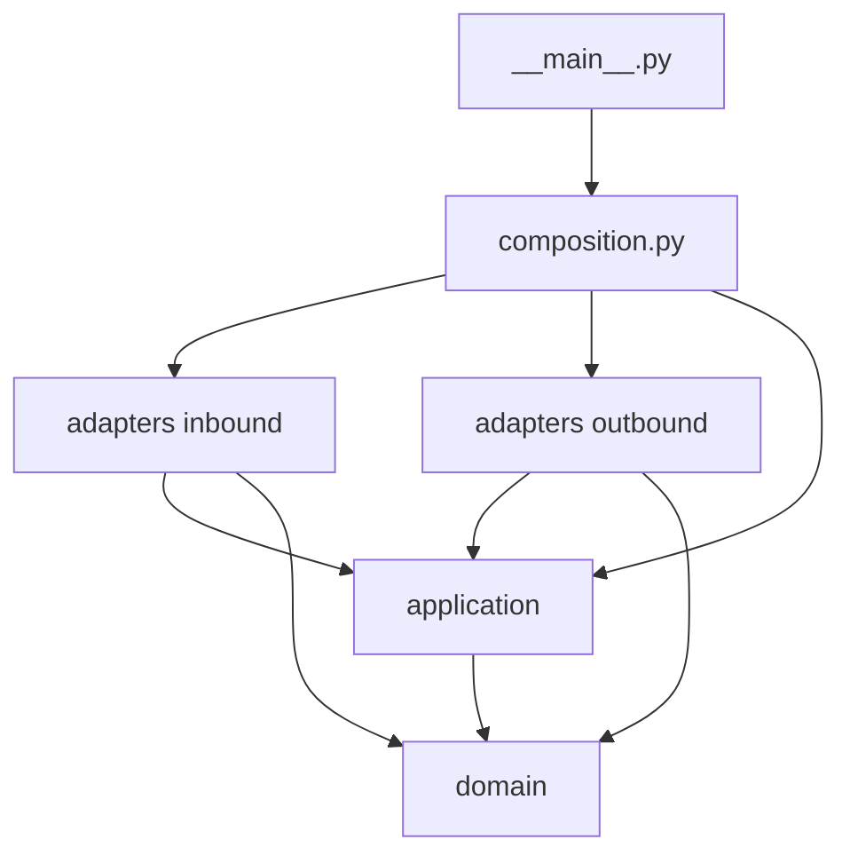
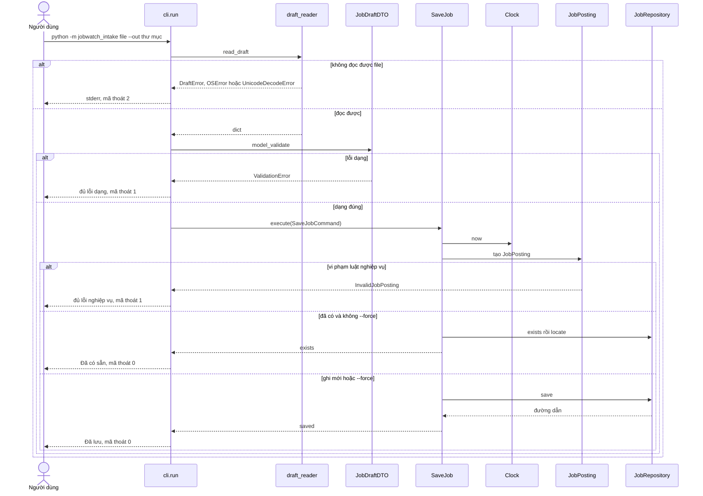

# Kiến trúc

Ba lớp. Mũi tên là chiều phụ thuộc: lớp ngoài biết lớp trong, lớp trong không biết lớp ngoài. `composition.py` là chỗ duy nhất biết cả use case lẫn adapter cụ thể. `__main__.py` là module duy nhất được import composition.

## Các lớp

Adapter ra không import adapter vào, và ngược lại. Domain chỉ dùng thư viện chuẩn. Application không dùng Pydantic và không import adapter.

## Luồng lưu một tin

## Từng file

| Đường dẫn | Lớp | Nhiệm vụ | Phụ thuộc vào | Ai dùng |
|---|---|---|---|---|
| `src/jobwatch_intake/__init__.py` | package | Đánh dấu gói Python | không | trình cài đặt |
| `src/jobwatch_intake/__main__.py` | composition | Gọi CLI với hàm ráp sẵn | cli, composition | `python -m jobwatch_intake` |
| `src/jobwatch_intake/composition.py` | composition | Tạo kho JSON và đồng hồ hệ thống, đưa vào SaveJob | application, adapters.outbound | `__main__.py` |
| `src/jobwatch_intake/domain/__init__.py` | domain | Đánh dấu gói | không | |
| `src/jobwatch_intake/domain/job_posting.py` | domain | JobPosting, Language, make_job_id, luật của tin | thư viện chuẩn | application, adapter, test |
| `src/jobwatch_intake/domain/gold_label.py` | domain | GoldLabel, LanguageNeed, các enum, luật của nhãn | thư viện chuẩn, job_posting | DTO nhãn, test |
| `src/jobwatch_intake/application/__init__.py` | application | Đánh dấu gói | không | |
| `src/jobwatch_intake/application/ports.py` | application | JobRepository và Clock, kiểu Protocol | domain | SaveJob |
| `src/jobwatch_intake/application/save_job.py` | application | Dựng tin, lưu một lần, báo saved hoặc exists | domain, ports | composition, cli |
| `src/jobwatch_intake/adapters/__init__.py` | adapters | Đánh dấu gói | không | |
| `src/jobwatch_intake/adapters/inbound/__init__.py` | adapters.inbound | Đánh dấu gói | không | |
| `src/jobwatch_intake/adapters/inbound/draft_reader.py` | adapters.inbound | Đọc file nháp thành dict | thư viện chuẩn | cli |
| `src/jobwatch_intake/adapters/inbound/dto.py` | adapters.inbound | JobDraftDTO và GoldLabelFileDTO | pydantic, domain, application | cli, make_schemas, test |
| `src/jobwatch_intake/adapters/inbound/cli.py` | adapters.inbound | argparse, thông báo, mã thoát 0/1/2 | draft_reader, dto, application, domain | `__main__.py` |
| `src/jobwatch_intake/adapters/outbound/__init__.py` | adapters.outbound | Đánh dấu gói | không | |
| `src/jobwatch_intake/adapters/outbound/json_job_repository.py` | adapters.outbound | Ghi `data/jobs/<id>.json` qua file tạm rồi os.replace | domain, stored_job_dto | composition |
| `src/jobwatch_intake/adapters/outbound/stored_job_dto.py` | adapters.outbound | Dạng JSON của tin đã lưu | pydantic, domain | kho JSON, make_schemas |
| `src/jobwatch_intake/adapters/outbound/system_clock.py` | adapters.outbound | UTC, làm tròn tới giây | thư viện chuẩn | composition |
| `tools/make_schemas.py` | công cụ | Sinh `schemas/*.schema.json` từ hai DTO | các DTO | người gán nhãn |
| `tests/test_architecture.py` | test | Quét import, chặn phụ thuộc ngược | thư viện chuẩn | pytest |
| `tests/domain/` | test | Luật tin và nhãn, không đụng file | domain | pytest |
| `tests/application/` | test | SaveJob với kho giả và đồng hồ cố định | application, domain | pytest |
| `tests/adapters/` | test | File nháp, file JSON, DTO, mã thoát | adapter, domain | pytest |

## Quyết định

Domain không dùng Pydantic. Pydantic kiểm tra dạng: trường có mặt, kiểu, ngày ISO, mã ngôn ngữ, trường lạ. Luật nghiệp vụ (độ dài, url, id, hạn nộp, kỹ năng, mức ngôn ngữ, số năm) ở lại trong domain và ném `InvalidJobPosting` hoặc `InvalidGoldLabel`, kèm đủ lỗi của đợt đó. Đổi cách kiểm tra dạng không làm đổi luật nghiệp vụ.

Cổng là `typing.Protocol`. Use case cần một kho và một đồng hồ, không cần biết đó là file JSON hay đồng hồ thật. Test truyền kho trong bộ nhớ và một giờ cố định. Không cần khung tiêm phụ thuộc.

Ghi file theo cách nguyên tử. Nội dung được ghi vào file tạm cùng thư mục, rồi `os.replace` đổi tên đè file thật. Mất điện giữa chừng chỉ hỏng file tạm, không để lại JSON viết dở. Sau khi đổi tên không còn file `.tmp`.

Id lấy từ URL đã chuẩn hóa: bỏ khoảng trắng hai đầu, bỏ phần `#`, bỏ dấu `/` cuối, đưa về chữ thường, rồi lấy 12 ký tự đầu của SHA-256 với tiền tố `job-`. Cùng một link thì cùng một id, kể cả khi hoa thường hoặc fragment khác. Nhờ vậy chạy lại không tạo bản thứ hai. Không có URL thì khóa là `công ty|tên việc|500 ký tự đầu nội dung`, cũng chữ thường.

## Thêm một kho khác

Ví dụ Postgres, không sửa domain:

1. Viết `PostgresJobRepository` trong `adapters/outbound`. Đủ ba thao tác của `JobRepository`: `exists`, `locate`, `save`. `locate` trả về một chuỗi để CLI in (có thể là id trong bảng).
2. Giữ nguyên `SaveJob`, `ports.py` và CLI. Use case không biết SQL.
3. Sửa `composition.py` để tạo repository mới thay cho `JsonJobRepository`. Đây là file duy nhất được đổi khi đổi kho.
4. Chạy `python -m pytest -q`. Test application vẫn dùng kho giả, nên không cần cơ sở dữ liệu để biết use case còn đúng.
