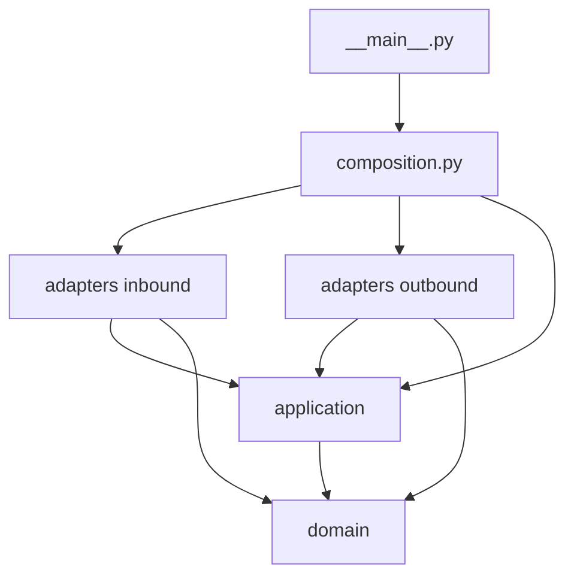
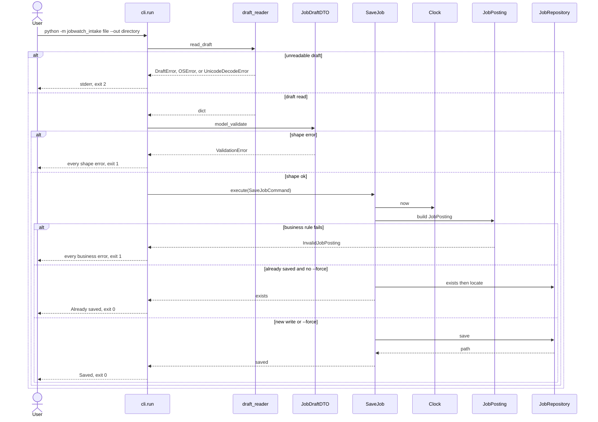

# Architecture

Three layers. An arrow is a dependency: an outer layer knows an inner layer, and an inner layer does not know an outer layer. `composition.py` is the only place that knows both the use case and a concrete adapter. `__main__.py` is the only module allowed to import composition.

## Layers

Outbound does not import inbound, and inbound does not import outbound. Domain uses only the standard library. Application does not use Pydantic and does not import an adapter.

## Saving one posting

## Each file

| Path | Layer | One-line job | Depends on | Used by |
|---|---|---|---|---|
| `src/jobwatch_intake/__init__.py` | package | Marks the Python package | nothing | the installer |
| `src/jobwatch_intake/__main__.py` | composition | Calls the CLI with the wired use case | cli, composition | `python -m jobwatch_intake` |
| `src/jobwatch_intake/composition.py` | composition | Builds the JSON store and the system clock, and passes them to SaveJob | application, adapters.outbound | `__main__.py` |
| `src/jobwatch_intake/domain/__init__.py` | domain | Marks the package | nothing | |
| `src/jobwatch_intake/domain/job_posting.py` | domain | JobPosting, Language, make_job_id, posting rules | standard library | application, adapters, tests |
| `src/jobwatch_intake/domain/gold_label.py` | domain | GoldLabel, LanguageNeed, the enums, label rules | standard library, job_posting | label DTO, tests |
| `src/jobwatch_intake/application/__init__.py` | application | Marks the package | nothing | |
| `src/jobwatch_intake/application/ports.py` | application | JobRepository and Clock, as Protocols | domain | SaveJob |
| `src/jobwatch_intake/application/save_job.py` | application | Builds a posting, saves it once, reports saved or exists | domain, ports | composition, cli |
| `src/jobwatch_intake/adapters/__init__.py` | adapters | Marks the package | nothing | |
| `src/jobwatch_intake/adapters/inbound/__init__.py` | adapters.inbound | Marks the package | nothing | |
| `src/jobwatch_intake/adapters/inbound/draft_reader.py` | adapters.inbound | Reads a draft file into a dict | standard library | cli |
| `src/jobwatch_intake/adapters/inbound/dto.py` | adapters.inbound | JobDraftDTO and GoldLabelFileDTO | pydantic, domain, application | cli, make_schemas, tests |
| `src/jobwatch_intake/adapters/inbound/cli.py` | adapters.inbound | argparse, messages, exit codes 0, 1, and 2 | draft_reader, dto, application, domain | `__main__.py` |
| `src/jobwatch_intake/adapters/outbound/__init__.py` | adapters.outbound | Marks the package | nothing | |
| `src/jobwatch_intake/adapters/outbound/json_job_repository.py` | adapters.outbound | Writes `data/jobs/<id>.json` through a temp file, then os.replace | domain, stored_job_dto | composition |
| `src/jobwatch_intake/adapters/outbound/stored_job_dto.py` | adapters.outbound | JSON shape of a saved posting | pydantic, domain | JSON store, make_schemas |
| `src/jobwatch_intake/adapters/outbound/system_clock.py` | adapters.outbound | UTC, rounded to the second | standard library | composition |
| `tools/make_schemas.py` | tool | Writes `schemas/*.schema.json` from the two DTOs | the DTOs | a person writing labels |
| `tests/test_architecture.py` | test | Scans imports and rejects a dependency that points outward | standard library | pytest |
| `tests/domain/` | test | Posting and label rules, no files | domain | pytest |
| `tests/application/` | test | SaveJob with a fake store and a fixed clock | application, domain | pytest |
| `tests/adapters/` | test | Draft file, JSON file, DTOs, exit codes | adapters, domain | pytest |

## Decisions

Domain does not use Pydantic. Pydantic checks shape: the field is present, the type, an ISO date, the language code, and an unknown field. Business rules (length, url, id, deadline, skills, language level, years) stay in the domain and raise `InvalidJobPosting` or `InvalidGoldLabel` with every error from that pass. Changing the shape check does not change the business rules.

Ports are `typing.Protocol`. The use case needs a store and a clock, and it does not need to know whether those are a JSON file and the real clock. Tests pass an in-memory store and a fixed time. No dependency-injection framework is required.

Files are written atomically. The bytes go to a temporary file in the same directory, then `os.replace` renames it over the real file. A crash mid-write can spoil only the temporary file, and it does not leave a half-written JSON file. After the rename, no `.tmp` file remains.

The id comes from the normalized URL: strip both ends, drop the `#` fragment, drop a trailing `/`, lowercase, then take the first 12 hex characters of SHA-256 with the prefix `job-`. The same link is always the same id, including a different letter case or a different fragment. A second run therefore does not create a second copy. With no URL, the key is `company|title|first 500 characters of text`, also lowercased.

## Adding another store

Postgres, for example, without editing the domain:

1. Write `PostgresJobRepository` in `adapters/outbound`. Implement the three `JobRepository` operations: `exists`, `locate`, and `save`. `locate` returns a string for the CLI to print (it can be the id in the table).
2. Leave `SaveJob`, `ports.py`, and the CLI as they are. The use case does not know SQL.
3. Change `composition.py` so it builds the new repository instead of `JsonJobRepository`. That is the only file that changes when the store changes.
4. Run `python -m pytest -q`. The application tests still use the fake store, so a database is not required to see that the use case is still correct.
